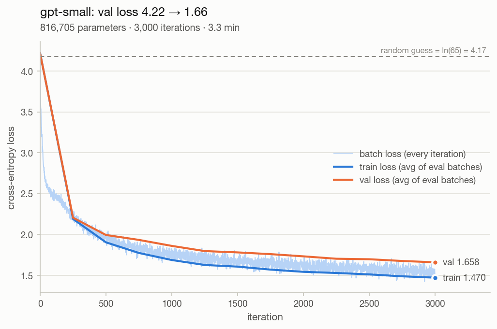
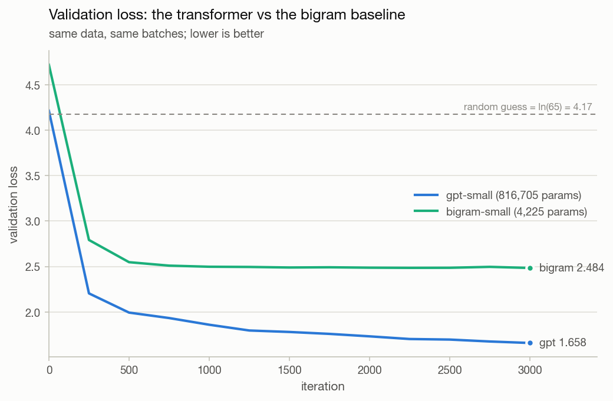
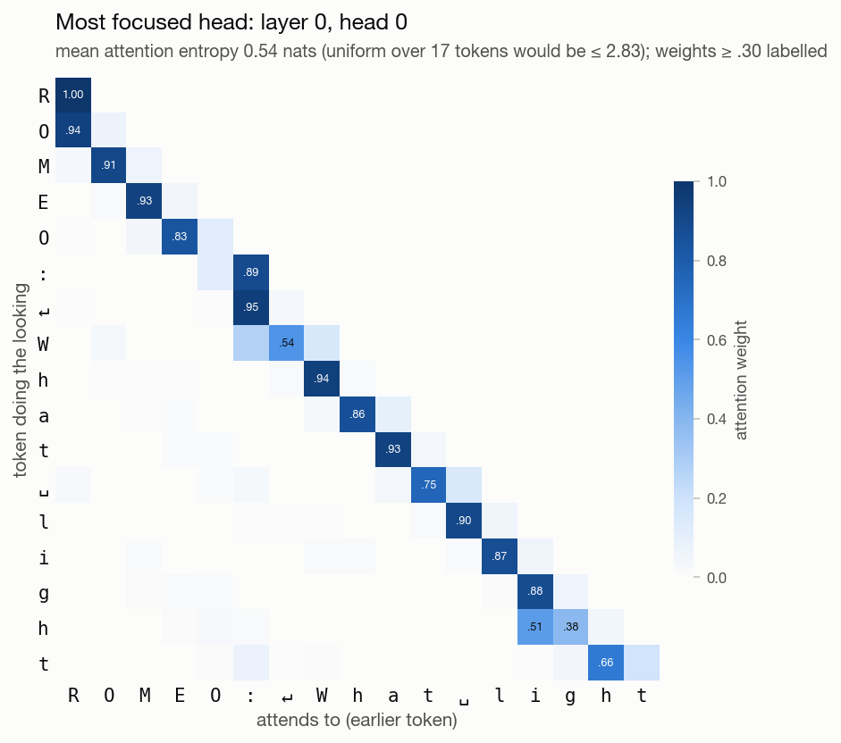

# minigpt — a GPT from scratch, with every calculation visible

A character-level GPT trained on Tiny Shakespeare, following Andrej Karpathy's
["Let's build GPT: from scratch, in code, spelled out"](https://github.com/karpathy/ng-video-lecture)
lecture. The maths is the same as the lecture's `bigram.py` and `gpt.py`, with three additions:

- **Everything is a class.** Config, tokenizer, dataset, layers, models, trainer,
  generator, checkpoint, plots and the CLI are all objects, with no globals and a docstring
  on every function.
- **Every step can print its calculations.** A `Tracer` is passed to every module and
  prints each intermediate tensor (shape, mean/std/min/max and a slice of the actual
  numbers) with the formula that produced it.
- **Every run is recorded.** Loss, validation loss, gradient norm and time of every
  iteration are saved and plotted.

📘 **[Interview guide](docs/INTERVIEW_GUIDE.md)**: how to explain the project, the results
in detail, and answers to 29 likely interview questions.

## Results

| | Bigram baseline | GPT (`small` preset) |
|---|---|---|
| Parameters | 4,225 | 816,705 |
| Final train loss | 2.4535 | 1.4703 |
| **Final validation loss** | **2.4840** | **1.6581** |
| Perplexity (e^val) | 12.0 | 5.25 |
| Training time (Apple silicon, MPS) | 8.7 s | 3.3 min |







More charts (gradient norm, all 16 attention heads, next-character probabilities, parameter
breakdown) are in the [interview guide](docs/INTERVIEW_GUIDE.md#5-results) and in
[`docs/images/`](docs/images).

Sample from the trained GPT (`python main.py generate --prompt "ROMEO:"`):

```
ROMEO:
Nay, my lord, what we else upon
in him.

YORK:
O, yet again
thou hate, when I do be fearfrious Lock,
```

### Saved outputs

| File | Contents |
|---|---|
| [`results/gpt-small/train.log`](results/gpt-small/train.log) | Console output of the GPT run: every iteration's loss, gradient norm and time, plus train/val loss every 250 iterations |
| [`results/gpt-small/history.json`](results/gpt-small/history.json) | The same metrics, machine-readable |
| [`results/gpt-small/sample.txt`](results/gpt-small/sample.txt) | 500 characters generated after training |
| [`results/bigram-small/`](results/bigram-small) | The same three files for the bigram baseline |
| [`results/explain-gpt-tiny.txt`](results/explain-gpt-tiny.txt) | Full output of `python main.py explain` (every calculation of one training step) |

## Quick start

```bash
pip install -r requirements.txt      # torch (+ matplotlib for charts)

python main.py explain               # 1 training step + generation, every number printed
python main.py train                 # train (~3 min on an M-series Mac), loss printed every iteration
python main.py generate --prompt "ROMEO:" --max-new-tokens 300
python main.py plot                  # redraw every chart from results/ into docs/images/
```

`data/input.txt` (Tiny Shakespeare) is downloaded automatically the first time.

## What `explain` shows

| Step | Calculations printed |
|---|---|
| 0 · Hyperparameters | every config value, `head_size = n_embd // n_head` |
| 1 · Data | vocabulary, `stoi`, `encode`/`decode`, the encoded data tensor, the 90/10 split |
| 2 · Model | every parameter tensor with its shape and size |
| 3 · Training step | `get_batch` (offsets, `x`, `y`, each context→target pair) → token + position embeddings → LayerNorm → per head: `k`, `q`, `q @ kᵀ / √hs`, causal mask, softmax, `wei @ v` → concat + projection → residual → feed-forward (with % zeroed by ReLU) → `ln_f` → logits → softmax → `p[target]` → `-log p` → loss vs. the `ln(vocab)` baseline → gradient norm of every parameter → AdamW update (weights before, gradient, after, change) → loss on the same batch after the update |
| 4 · Generation | for each sampled character: logits of the last position, probabilities, top-5 candidates as a bar chart, the sampled character |

Useful flags:

```bash
python main.py explain --model bigram                 # the bigram.py model instead
python main.py explain --detail-layers 2 --detail-heads 2   # trace every block and head
python main.py explain --rows 4 --cols 16             # how much of each matrix to print
python main.py explain --preset small                 # trace the bigger model (slices of it)
```

## Training

```bash
python main.py train                         # 'small' preset, logs: iter | loss | grad norm | ms
python main.py train --preset lecture        # the exact gpt.py hyperparameters (10.8M params)
python main.py train --trace-every 500       # also dump a full calculation trace every 500 iterations
python main.py train --log-every 10          # fewer log lines
python main.py train --max-iters 1000 --learning-rate 3e-4 --n-layer 6   # any hyperparameter can be overridden
python main.py train --model bigram --learning-rate 1e-2                 # the baseline in the results table
```

Every `eval_interval` steps it prints the average train/val loss (as in the lecture). Each
run writes `train.log`, `history.json` and `sample.txt` to `results/<model>-<preset>/`
(change with `--results-dir`). Press Ctrl-C at any time and the model trained so far is still
saved to `checkpoints/<model>.pt`. Then use `generate`:

```bash
python main.py generate --checkpoint checkpoints/gpt.pt --prompt "First Citizen:" --trace-tokens 5
```

`--trace-tokens N` prints the probability distribution behind the first N characters.

| Preset | B | T | C | heads | layers | params | speed (M-series, MPS) |
|---|---|---|---|---|---|---|---|
| `tiny` | 4 | 8 | 16 | 2 | 2 | 9K | ~2 ms/iter on CPU, made for reading traces |
| `small` | 32 | 64 | 128 | 4 | 4 | 0.8M | ~56 ms/iter, about 3.3 min for 3000 iters |
| `lecture` | 64 | 256 | 384 | 6 | 6 | 10.8M | ~0.8 s/iter, about 70 min for 5000 iters |

## Code map

| File | Classes | Lecture equivalent |
|---|---|---|
| [minigpt/config.py](minigpt/config.py) | `GPTConfig`, `PRESETS` | hyperparameter globals at the top of `gpt.py` |
| [minigpt/data.py](minigpt/data.py) | `Corpus`, `CharTokenizer`, `TextDataset` | reading `input.txt`, `encode`/`decode`, train/val split, `get_batch` |
| [minigpt/layers.py](minigpt/layers.py) | `Head`, `MultiHeadAttention`, `FeedForward`, `Block` | the same classes in `gpt.py` |
| [minigpt/models.py](minigpt/models.py) | `LanguageModel` (base), `BigramLanguageModel`, `GPTLanguageModel` | `bigram.py` / `gpt.py` models, `generate` |
| [minigpt/trainer.py](minigpt/trainer.py) | `Trainer` | `estimate_loss` and the training loop |
| [minigpt/generator.py](minigpt/generator.py) | `TextGenerator` | the final `decode(m.generate(...))` |
| [minigpt/history.py](minigpt/history.py) | `TrainingHistory`, `ConsoleLog` | (new) records metrics and the console log |
| [minigpt/plots.py](minigpt/plots.py) | `TrainingPlots` | (new) every chart |
| [minigpt/checkpoint.py](minigpt/checkpoint.py) | `Checkpoint` | (new) save/load trained models |
| [minigpt/tracer.py](minigpt/tracer.py) | `Tracer` | (new) prints every calculation |
| [minigpt/walkthrough.py](minigpt/walkthrough.py) | `Walkthrough` | (new) the `explain` command |
| [main.py](main.py) | `GPTApp` | command-line entry point |

The tracer costs almost nothing when it is off: every trace call returns immediately,
so the same model code is used for both explaining and fast training.

Note: the loss is computed by hand as `-log_softmax(logits).gather(targets).mean()`.
This is the same maths as `F.cross_entropy` (loss and gradients match to float precision),
but it shows each step, and it avoids a crash in `F.cross_entropy` on Apple MPS with torch 2.0.
