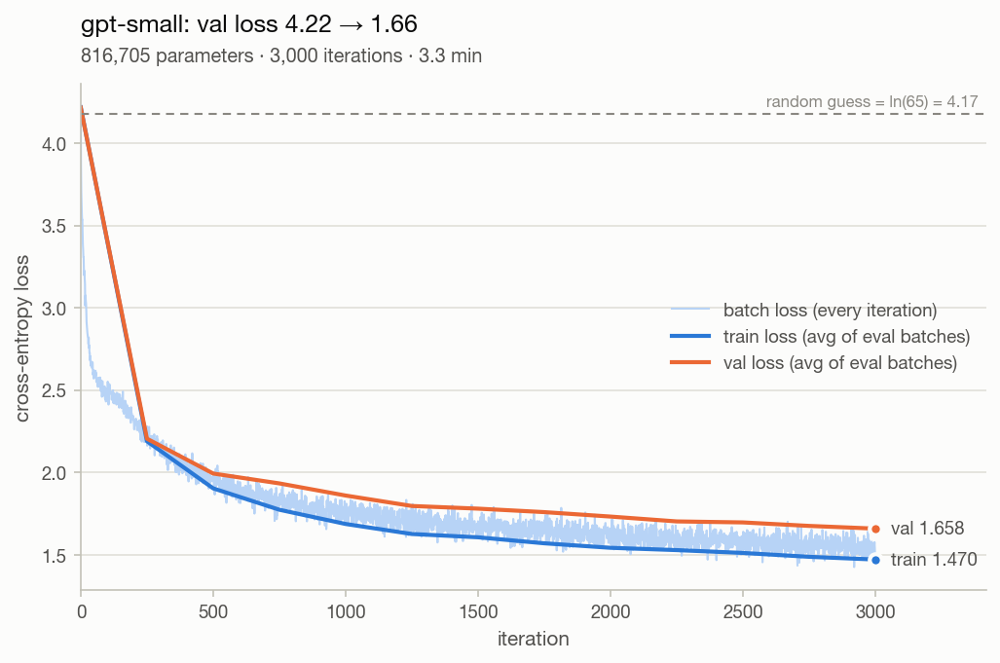
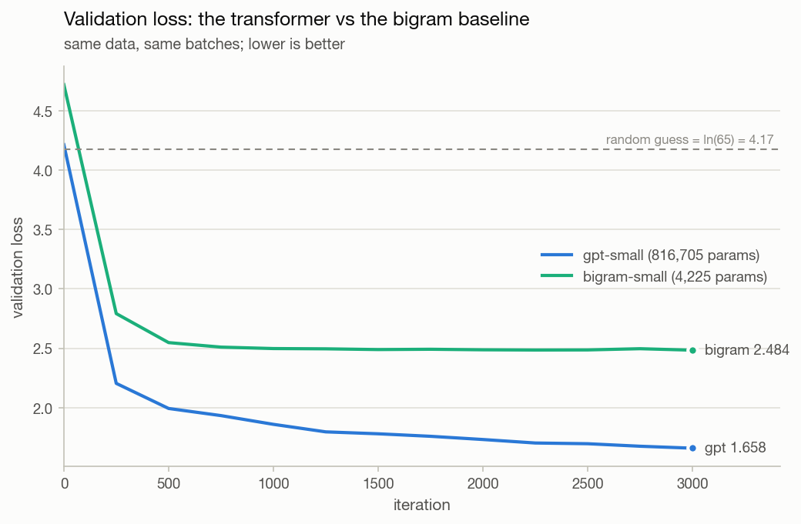
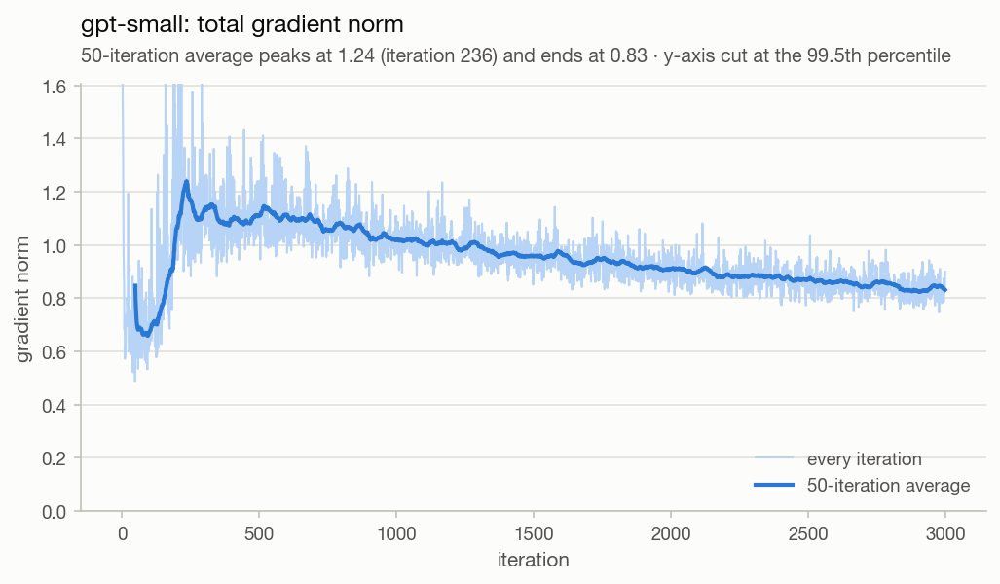
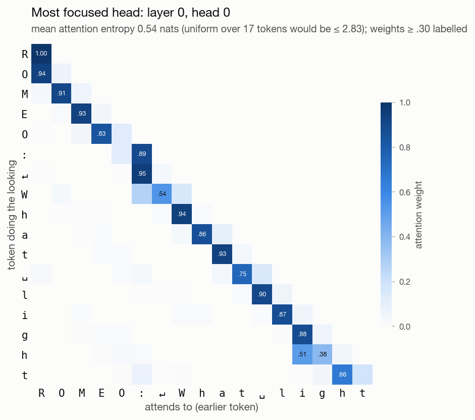
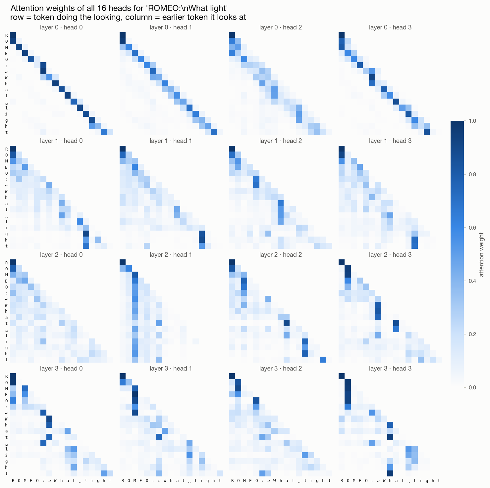
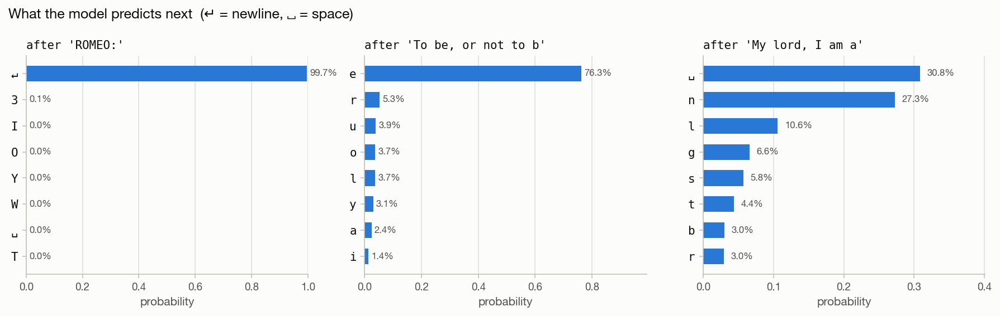
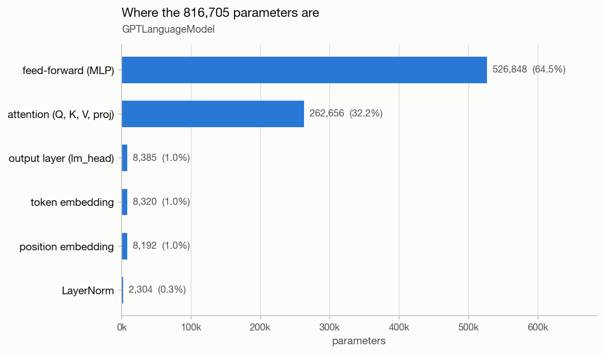

# minigpt — Interview Guide

How to explain this project, what the results mean, and answers to the questions an
interviewer is likely to ask. All numbers come from the runs saved in [`results/`](../results).

---

## 1. The pitch

### 30 seconds

> I built a GPT-style language model from scratch in PyTorch and trained it on the complete
> works of Shakespeare (1.1M characters). It's a decoder-only transformer: token and position
> embeddings, 4 blocks of causal multi-head self-attention plus feed-forward layers, and a
> linear head that predicts the next character. It follows Andrej Karpathy's "Let's build
> GPT" lecture. I restructured it into a fully object-oriented package and added a tracing
> system that prints every intermediate tensor (Q, K, V, attention scores, the mask, softmax,
> loss, gradients, the weight update) so you can watch the maths happen. The 0.8M-parameter
> model trains in 3.3 minutes on a MacBook and reaches a validation loss of **1.66**,
> versus **2.48** for a bigram baseline.

### 2 minutes (walk through the pipeline)

1. **Data.** The text is split into characters. There are 65 unique ones, and each gets an
   integer id. 90% of the text is for training and the last 10% is held out for validation.
2. **Batches.** I sample 32 random windows of 64 characters. The target for every position
   is the next character, so one window gives 64 training examples at once.
3. **Embeddings.** Each id looks up a 128-dimensional learned vector, and a second table adds
   a learned vector for each *position*. Attention has no built-in sense of order, so this is
   how the model knows where each character sits.
4. **Attention.** Each character produces a query ("what am I looking for"), a key ("what do
   I contain") and a value ("what I'll pass on"). Query·key scores, scaled by 1/√32, say how
   much each character should listen to every earlier one. A triangular mask blocks the
   future. Softmax turns the scores into weights, and the output is the weighted sum of values.
   There are 4 heads in parallel per block.
5. **Feed-forward.** A per-character MLP (128 → 512 → 128) processes what attention gathered.
   Residual connections and LayerNorm around both parts keep training stable.
6. **Output.** A linear layer maps each position to 65 scores (logits). Cross-entropy against
   the true next character gives the loss, backprop gives the gradients, and AdamW updates the
   weights.
7. **Generation.** Start from a character, take the softmax of the last position's logits,
   sample a character, append it, and repeat.

---

## 2. What is Karpathy's and what I added

Be clear about this in the interview. It shows integrity and makes your own contributions
stand out.

| From the lecture | What I built on top |
|---|---|
| The model maths: `Head`, `MultiHeadAttention`, `FeedForward`, `Block`, GPT and bigram models | Fully OOP package: no globals. Config, tokenizer, dataset, trainer, generator, checkpoint and CLI are all classes |
| Hyperparameters of `gpt.py` (kept as the `lecture` preset) | A `Tracer` that prints every intermediate calculation, a `Walkthrough` (`explain` command) of one full training step |
| The training loop and `estimate_loss` | Metrics history (`TrainingHistory`), console log capture, checkpoints, a `plot` command with 8 charts |
| | Attention-map extraction from the trained model, presets (`tiny`/`small`/`lecture`), CLI overrides for every hyperparameter |
| | Debugged and fixed a crash on Apple-silicon GPUs (see §7) |
| | Docstrings on every function, this guide |

---

## 3. Architecture

### Data flow, with the shapes of the `small` preset (B=32, T=64, C=128, 4 heads, 4 layers)

```
"ROMEO:\nWhat light"                                   text
      │  CharTokenizer.encode
      ▼
idx  (B, T) = (32, 64)        integers in 0..64
      │  token_embedding_table (65×128)      position_embedding_table (64×128)
      ▼                                        ▼
tok_emb (32, 64, 128)          +          pos_emb (64, 128)      → x (32, 64, 128)
      │
      ▼   repeated for 4 Blocks
┌────────────────────────────────────────────────────────────┐
│  x = x + MultiHeadAttention( LayerNorm(x) )   4 heads × 32  │   "communication"
│  x = x + FeedForward( LayerNorm(x) )          128→512→128   │   "computation"
└────────────────────────────────────────────────────────────┘
      │  ln_f  (final LayerNorm)
      ▼
lm_head  Linear(128 → 65)
      ▼
logits (32, 64, 65)  ── softmax ──►  P(next character) at every position
      │  cross-entropy against targets y (32, 64)
      ▼
loss (scalar)  ── loss.backward() ──►  gradients  ── AdamW.step() ──►  new weights
```

### Inside one attention head

```
x (B,T,C) ──┬── key(x)   → k (B,T,hs)       hs = head_size = C / n_head = 32
            ├── query(x) → q (B,T,hs)
            └── value(x) → v (B,T,hs)

wei = q @ kᵀ · hs^-0.5                        (B,T,T)   affinity of every pair
wei = wei.masked_fill(tril == 0, -inf)                  block the future
wei = softmax(wei, dim=-1)                              each row sums to 1
out = wei @ v                                 (B,T,hs)  weighted average of values
```

In one formula: **Attention(Q, K, V) = softmax(QKᵀ / √d_k + M) · V**, where M is 0 on and
below the diagonal and −∞ above it.

### Code map (one class per responsibility)

| Class | File | Responsibility |
|---|---|---|
| `GPTConfig` | `minigpt/config.py` | Hyperparameters as a dataclass; presets; device auto-detection |
| `Corpus`, `CharTokenizer`, `TextDataset` | `minigpt/data.py` | Load text, encode/decode characters, train/val split, random batches |
| `Head`, `MultiHeadAttention`, `FeedForward`, `Block` | `minigpt/layers.py` | Transformer building blocks |
| `LanguageModel` → `BigramLanguageModel`, `GPTLanguageModel` | `minigpt/models.py` | Base class holds the shared loss and generation; subclasses only implement `compute_logits` |
| `Trainer` | `minigpt/trainer.py` | AdamW, training loop, loss estimation, gradient/update tracing |
| `TrainingHistory`, `ConsoleLog` | `minigpt/history.py` | Record and save every metric; copy console output to a log file |
| `TextGenerator` | `minigpt/generator.py` | String in, string out |
| `Checkpoint` | `minigpt/checkpoint.py` | Save/load weights + config + vocabulary together |
| `Tracer` | `minigpt/tracer.py` | Pretty-prints tensors; no-op when disabled |
| `Walkthrough` | `minigpt/walkthrough.py` | The `explain` command |
| `TrainingPlots` | `minigpt/plots.py` | All charts |
| `GPTApp` | `main.py` | Command-line interface |

**Design points worth mentioning:**

- **Dependency injection.** One `Tracer` object is passed into every module's constructor,
  so no module depends on global state.
- **Null-object pattern.** `tracer.focus(layer, head)` returns either the real tracer or a
  *muted* one. Modules call `tr.tensor(...)` unconditionally, with no `if` checks everywhere,
  and the call returns immediately when muted. The same model code serves both fast training
  and full explanation.
- **Template method.** `LanguageModel.forward` calls the abstract `compute_logits` and the
  shared `compute_loss`. Adding a new model means writing one method.
- **Registry + factory.** `LanguageModel.create("gpt", cfg, tracer)` picks the class from
  `MODEL_TYPES`, which lets the checkpoint rebuild the right class from a string.

---

## 4. The "see every calculation" feature

`python main.py explain` runs one training step on a tiny model (B=4, T=8, C=16) and prints
every step. This excerpt is the attention weights of head 0 after the causal mask and softmax:

```
│ │ │ │ ▸ wei.masked_fill(tril == 0, -inf)  shape=(4, 8, 8)   ← a token may not look at the future
│ │ │ │     [-0.0131    -inf    -inf    -inf    -inf    -inf    -inf    -inf]
│ │ │ │     [+0.0023 -0.0070    -inf    -inf    -inf    -inf    -inf    -inf]
│ │ │ │     [+0.0046 -0.0010 +0.0005    -inf    -inf    -inf    -inf    -inf]
│ │ │ │ ▸ wei = softmax(wei, dim=-1)  shape=(4, 8, 8)   ← -inf → 0, each row becomes weights summing to 1
│ │ │ │     [+1.0000 +0.0000 +0.0000 +0.0000 +0.0000 +0.0000 +0.0000 +0.0000]
│ │ │ │     [+0.5023 +0.4977 +0.0000 +0.0000 +0.0000 +0.0000 +0.0000 +0.0000]
│ │ │ │     [+0.3344 +0.3326 +0.3331 +0.0000 +0.0000 +0.0000 +0.0000 +0.0000]
```

At initialisation the scores are near zero, so attention is almost exactly uniform over
the past: 1, ½, ⅓, … Training is what makes it selective (see the attention charts below).

The same run shows:
- The initial loss is **4.1774**, against **4.1744** = ln(65) for random guessing. This confirms
  the initialisation is sane.
- After one AdamW step every weight of `lm_head` moved by **exactly ±0.001** (= the learning
  rate). On step one Adam's m̂/√v̂ equals sign(g), so each weight moves by lr against its
  gradient.
- The loss on the same batch dropped from 4.1774 to **4.1282** after that one update.

The full output is in [`results/explain-gpt-tiny.txt`](../results/explain-gpt-tiny.txt).

---

## 5. Results

### Final numbers

| | Bigram baseline | GPT (`small`) |
|---|---|---|
| Parameters | 4,225 | 816,705 |
| Context used | 1 character | up to 64 characters |
| Iterations | 3,000 | 3,000 |
| Learning rate | 1e-2 (as in `bigram.py`) | 1e-3 |
| Final train loss | 2.4535 | 1.4703 |
| **Final validation loss** | **2.4840** | **1.6581** |
| Perplexity = e^val loss | 12.0 | 5.25 |
| Train − val gap | 0.03 | 0.19 |
| Median time per iteration | 1.9 ms | 56.3 ms |
| Total training time (incl. evaluation) | 8.7 s | 3.3 min |

Hardware: an Apple-silicon Mac using the MPS GPU backend. For comparison, the `lecture`
preset (10.8M parameters) reaches about 1.48 in Karpathy's lecture; on this Mac it would
take about 70 minutes.

**Perplexity in one sentence:** a perplexity of 5.25 means that, on average, the model is as
unsure as if it were choosing uniformly among ~5 characters, down from 65 at random and 12
for the bigram.

### GPT validation loss during training

| Iteration | 0 | 250 | 500 | 750 | 1000 | 1500 | 2000 | 2500 | 2999 |
|---|---|---|---|---|---|---|---|---|---|
| Train loss | 4.218 | 2.189 | 1.903 | 1.773 | 1.686 | 1.605 | 1.542 | 1.510 | 1.470 |
| Val loss | 4.215 | 2.204 | 1.993 | 1.933 | 1.859 | 1.779 | 1.731 | 1.696 | 1.658 |

The complete per-iteration log (3,000 lines: loss, gradient norm and time of every step) is
[`results/gpt-small/train.log`](../results/gpt-small/train.log). The machine-readable version
is [`history.json`](../results/gpt-small/history.json).

### Loss curves



**How to read it:** the light line is the loss of each random batch. It's noisy because
every batch is different. The two solid lines average 100 batches each, which is why
`estimate_loss` exists. Most of the learning happens in the first 500 iterations; after that
it's slow refinement. Validation is still decreasing at 3,000 iterations, so the model is
**under-trained**, not over-fitted. More iterations would still help.

### Transformer vs bigram



The bigram flattens at ~2.48 after 1,000 iterations. That is the best possible when you only
look at the previous character: it can't do better however long it trains. The GPT keeps
improving because attention lets it use the whole 64-character context.

Notice the bigram **starts above** the random-guess line (4.72 > 4.17). Its embedding table
is initialised N(0, 1), so its first predictions are confidently wrong. The GPT initialises
weights with std 0.02, so its logits start near zero and its predictions near uniform.

### Gradient norm



The pattern lines up with the loss:

| Iterations | Mean batch loss | Mean gradient norm |
|---|---|---|
| 0–49 | 3.005 | 0.847 |
| 50–99 | 2.532 | **0.671** (lowest) |
| 100–149 | **2.462** (≈ bigram's best, 2.48) | 0.778 |
| 150–199 | 2.378 | 1.063 |
| 200–249 | 2.261 | **1.167** |
| 500–549 | 1.943 | 1.122 |

Within ~100 iterations the GPT reaches the loss of the bigram model. That is what you can get
from "which character follows which", learnable through the embeddings alone. The gradient is
at its smallest there. The gradient norm then jumps as the loss breaks *below* the bigram
level, which takes context. My interpretation, consistent with the data but not proven, is
that this is when attention starts contributing. Afterwards the 50-step average peaks at
**1.24 (iteration 236)** and slowly declines to **0.83**. There are no spikes, so gradient
clipping wasn't needed at this scale.

### What attention learned



Each row is a character and each column an earlier character it can look at. **Layer 0,
head 0 is a "previous-character head"**: 15 of the 17 characters put most of their attention
(0.54–0.95) on the character immediately before them. The two exceptions are `:`, which
attends to itself, and the second `h` in "light", which splits its attention between `i` and
`g`. Nobody programmed this; it emerged from training. The model needs it because a
character's own embedding says nothing about its neighbour.



Across all 16 heads, layer 0 is dominated by sharp, local, previous-character patterns.
Deeper layers are more spread out and longer-range, and some form vertical stripes where many
characters attend to the same earlier position. Different heads specialise in different
relationships, which is the point of having multiple heads.

### What the model predicts next



- After `ROMEO:` it predicts a newline with **99.7%** certainty. It learned the play format:
  a speaker's name is followed by a line break.
- After `To be, or not to b` it predicts **e** (76.3%).
- After `My lord, I am a` it's genuinely uncertain: **space** 30.8% ("a …"), **n** 27.3%
  ("an …"), **l** 10.6%. This is a reasonable spread over plausible continuations.

### Where the parameters are



Two-thirds of the parameters are in the feed-forward layers. Per block: attention = 4C² + C,
FFN = 8C² + 5C, LayerNorms = 4C, so **12C² + 10C** in total. With C = 128 that's 197,888 per
block, × 4 blocks = 791,552. Add the embeddings, final LayerNorm and head (25,153) to get
**816,705**. Being able to derive this by hand is a common interview check.

### Sample output

GPT, prompt `ROMEO:`:
```
ROMEO:
Nay, my lord, what we else upon
in him.

YORK:
O, yet again
thou hate, when I do be fearfrious Lock,
Wilt in present be the gobsent. Awill I father
```

Bigram:
```
Foasthandse tize herst el
O d fZEie hy:

Hak, CORineg agnthe thrr Masearor charnge?
```

The GPT has learned speaker names in capitals followed by a colon and a newline, line
lengths, punctuation, and mostly-real English words. It has **not** learned meaning. That
takes far more parameters, data and context. The bigram only knows which letter tends to
follow which.

---

## 6. Training details

| Setting | Value (`small`) | Why |
|---|---|---|
| Optimiser | AdamW, lr 1e-3, default β = (0.9, 0.999), weight decay 0.01 | Per-parameter adaptive step sizes; decoupled weight decay |
| Batch | 32 sequences × 64 characters = 2,048 predictions per step | Each position is its own example |
| Dropout | 0.1 on attention weights, projections and the FFN output | Regularisation; switched off by `model.eval()` |
| Evaluation | every 250 iterations, 100 batches per split | One batch is too noisy to judge progress |
| Initialisation | N(0, 0.02) for Linear/Embedding weights, zero biases | Starts with near-uniform predictions (loss ≈ ln 65) |
| Seed | 1337 | Reproducible runs |

---

## 7. A debugging story (good for "tell me about a problem you solved")

- **Situation.** The first training run on the Mac's GPU (MPS) died instantly with exit code
  138 and printed nothing, not even the line before the crash.
- **Task.** Find the cause without access to PyTorch internals, and fix it without changing
  the maths.
- **Action.**
  1. Exit code 138 = 128 + 10 = SIGBUS, a native crash, not a Python exception. Nothing printed
     because stdout was buffered when the process died, so I also made the CLI line-buffered.
  2. I reran with `python -X faulthandler`, which pointed at `F.cross_entropy`.
  3. I isolated the operations one by one on MPS. `log_softmax` works; `nll_loss` (which
     `cross_entropy` uses internally) crashes. This is a bug in PyTorch 2.0's MPS backend on
     this macOS version.
  4. I wrote cross-entropy by hand: `-log_softmax(logits).gather(1, targets).mean()`.
  5. I verified it was the same function: `torch.allclose` on both the loss and the gradients
     against `F.cross_entropy` (on CPU, where both work).
- **Result.** Training works on the GPU. It's 3.4× faster than CPU for the lecture-size model
  (0.8 s vs 2.7 s per step). The explicit loss also became part of the step-by-step trace.

---

## 8. Likely interview questions, with answers

### Fundamentals

**Q: What does the model actually learn?**
A: The probability distribution of the next character given up to 64 previous characters,
P(xₜ₊₁ | x₁…xₜ). Training maximises the likelihood of the real text under that
distribution, which is the same as minimising cross-entropy.

**Q: Why is the initial loss 4.17? How did you use that?**
A: With 65 characters, a model that knows nothing assigns each one probability 1/65, and
−ln(1/65) = 4.17. My measured initial loss was 4.1774, which tells me the initialisation is
correct. If it had been much higher, the model would be confidently wrong at the start,
which wastes the first part of training. The bigram (4.72) shows exactly that.

**Q: What's the difference between this and ChatGPT?**
A: It's the same core architecture: a decoder-only transformer trained on next-token
prediction. The differences are scale (0.8M vs hundreds of billions of parameters), a
sub-word BPE tokenizer instead of characters, far more data, and, for ChatGPT, extra stages
after pre-training: supervised fine-tuning on conversations and RLHF. This project is the
pre-training stage only.

**Q: Decoder-only vs encoder vs encoder-decoder?**
A: Decoder-only (GPT) uses causal masking and generates text left to right. An encoder (BERT)
lets every token see every other token: good for understanding, not for generation. The
original Transformer was encoder-decoder for translation, with cross-attention from the
decoder to the encoder. Here there is only self-attention, and Q, K and V all come from the
same sequence.

**Q: Why characters instead of words or BPE?**
A: Simplicity. A 65-symbol vocabulary is tiny, and nothing is ever out of vocabulary. The
cost is longer sequences for the same text, so 64 characters is only about 12 words of
context. GPT-2 uses BPE with 50,257 tokens, which compresses text about 4× and gives much
more context per position.

### Attention

**Q: Explain self-attention in plain words.**
A: Every token asks a question (query), advertises what it has (key) and offers some
information (value). Query·key dot products measure relevance. Softmax turns them into
weights, and each token's output is a weighted average of the values of the tokens it
attends to. It is data-dependent communication between positions.

**Q: Why divide by √head_size?**
A: If q and k have unit-variance entries, their dot product over d dimensions has variance
d. Large scores push softmax towards a one-hot distribution, and its gradients vanish.
Dividing by √d keeps the variance around 1, so softmax stays diffuse at initialisation and
gradients flow.

**Q: Why the causal mask? What happens without it?**
A: All 64 positions are trained in parallel, and position t must predict token t+1 without
seeing it. Without the mask, the model would copy the answer from the future: training loss
would collapse, but generation would be garbage, because at inference the future doesn't
exist. Setting future scores to −∞ makes softmax give them exactly zero weight.

**Q: Why multiple heads instead of one big head?**
A: Each head can specialise in a different relationship: the chart shows a
previous-character head in layer 0 and longer-range heads in later layers. Four heads of 32
dimensions cost the same as one head of 128, but give four independent attention patterns.

**Q: Why do you need position embeddings?**
A: Attention is permutation-invariant: shuffle the inputs and the outputs shuffle the same
way, so without positions "dog bites man" = "man bites dog". I use learned absolute position
embeddings (a 64×128 table). The downside is that the model can't handle sequences longer
than 64, which is why `generate` crops the context to the last `block_size` characters.
Alternatives are sinusoidal encodings, RoPE (Llama) or ALiBi.

**Q: What's the complexity of attention?**
A: O(T²·C) time and O(T²) memory per head for the T×T score matrix. That quadratic cost in
sequence length is why long context is expensive. FlashAttention avoids materialising the
T×T matrix; sparse or linear attention change the maths.

### Architecture

**Q: Why residual connections?**
A: `x = x + f(x)` gives gradients a direct path from the loss to every layer (addition passes
gradients through unchanged). Each block only has to learn a correction to the residual
stream. Without them, deep stacks are hard to train.

**Q: What does LayerNorm do, and why before the sub-layer?**
A: It normalises each token's feature vector to mean 0 and variance 1, then applies a learned
scale and shift. That keeps activations in a stable range. I use pre-norm, `x + f(LN(x))`, as
in GPT-2; the original Transformer used post-norm. Pre-norm keeps the residual path clean and
is more stable to train, especially when deep.

**Q: What is the feed-forward layer for if attention already mixes information?**
A: Attention *moves* information between positions; the MLP *processes* it at each position
independently. It's 64.5% of the parameters. The 4× expansion (128 → 512) gives room for
non-linear features before projecting back.

**Q: Why dropout, and where?**
A: Regularisation: randomly zeroing 10% of activations stops the network relying on any
single path. I apply it to attention weights, the attention projection and the FFN output,
during training only. `estimate_loss` and `generate` call `model.eval()` to disable it.

**Q: What is `register_buffer("tril", ...)` for?**
A: The mask is part of the module's state, but it isn't trained. A buffer moves with
`.to(device)` and is saved in the `state_dict`, but the optimiser never sees it.

### Training

**Q: Why AdamW and not plain SGD?**
A: Adam keeps running averages of each parameter's gradient (m) and squared gradient (v) and
scales every step by m̂/√v̂, so every parameter gets a sensible step size regardless of its
gradient scale. The "W" means weight decay is applied directly to the weights, not mixed into
the gradient. You can see it in the trace: on step one every weight moves by exactly ±lr.

**Q: How do you know it isn't just memorising the text?**
A: The validation loss is measured on the last 10% of the text, which the model never trains
on, and it's within 0.19 of the training loss. The samples are new combinations, and the
misspellings ("fearfrious") show it isn't copying. A large or growing train-val gap would
signal memorisation.

**Q: Is the model over-fitting or under-fitting?**
A: Slightly under-trained. Validation loss is still decreasing at the last iteration. The
0.19 train-val gap is a mild generalisation gap, with dropout keeping it in check. Next steps
would be more iterations, then a bigger model (the `lecture` preset), watching the gap.

**Q: Why average the loss over 100 batches for evaluation?**
A: A single batch's loss is very noisy; see the light line in the loss chart. Averaging gives
a reliable signal. It runs under `@torch.no_grad()` because no gradients are needed, which
saves memory and time.

**Q: What does the gradient-norm chart tell you?**
A: That training was stable: no explosions or collapse, so no gradient clipping was needed. It
is smallest (~0.67) around iterations 50–100, exactly when the loss reaches bigram level
(~2.46). It then rises to ~1.2 as the model goes beyond what a bigram can do, and slowly
declines after. In bigger models you'd monitor it for spikes and usually clip at 1.0.

### Generation

**Q: How does generation work?**
A: Autoregressively. Feed the context, take the logits at the *last* position, apply softmax,
sample one character with `torch.multinomial`, append it, and repeat. The context is cropped
to the last 64 characters because the position table has only 64 rows.

**Q: Why sample instead of always taking the most likely character?**
A: Greedy argmax tends to produce repetitive loops. Sampling produces varied text. You can
control the trade-off with *temperature* (divide the logits by T before softmax: below 1 is
safer, above 1 is more random), *top-k*, or *nucleus (top-p)* sampling.

**Q: Your `generate` recomputes the whole context every step. How would you speed it up?**
A: With a **KV cache**: store each layer's keys and values for the tokens already processed,
and for each new token compute only its own q, k and v. That changes the cost per new token
from re-processing T tokens to processing one.

### Engineering / design

**Q: Why OOP? Isn't Karpathy's single file simpler?**
A: For a 200-line script, yes. Splitting by responsibility made the extensions easy. The
tracer, history, plotting and checkpointing were each added without touching the model's
maths. Swapping bigram for GPT is a one-word flag because both share a base class, and every
hyperparameter is overridable from the CLI because the config is a dataclass.

**Q: Doesn't all that tracing slow down training?**
A: No. Every trace method checks `self.enabled` and returns immediately. Expensive
diagnostics (decoding text, counting zeros after ReLU) sit behind `if tr.enabled`. Training
runs with tracing off and is the same speed as the plain version.

**Q: How would you test this code?**
A: Shape tests for each module; a test that the hand-written loss equals `F.cross_entropy`
(I verified this); a causality test, where changing a future token must not change earlier
logits; a test that the initial loss ≈ ln(vocab); an overfit-one-batch test, where loss
should approach 0; and a checkpoint save → load → identical-logits test.

### Scaling and improvements

**Q: How would you make it better?**
A: In order of impact:
1. Train longer, then use the `lecture` preset (10.8M params, about 1.48 validation loss in
   the lecture).
2. Add a learning-rate warmup and cosine decay, and gradient clipping.
3. Use a BPE tokenizer for more context per position.
4. Use `F.scaled_dot_product_attention` (FlashAttention) and mixed precision for speed.
5. Tie the token-embedding and `lm_head` weights (GPT-2 does this).
6. Add a KV cache and temperature/top-k sampling for generation.
7. Upgrade PyTorch for faster MPS kernels (and the fixed `cross_entropy`).

**Q: What would change to train a real LLM?**
A: Billions of tokens of diverse data, BPE tokenisation, much larger models, and distributed
training (data/tensor/pipeline parallelism). Then mixed precision, careful learning-rate
schedules, and evaluation on benchmarks. After pre-training: instruction fine-tuning and
RLHF/DPO to make it a helpful assistant.

---

## 9. Numbers cheat sheet

| Fact | Value |
|---|---|
| Dataset | Tiny Shakespeare, 1,115,394 characters, 65 unique |
| Train / val split | 1,003,854 / 111,540 characters (90 / 10) |
| `small` model | 4 layers, 4 heads, C = 128, head_size = 32, context 64 |
| Parameters | 816,705 (bigram: 4,225; `lecture`: 10,788,929) |
| Parameters per block | 12C² + 10C = 197,888 |
| Initial loss | 4.1774 (theory: ln 65 = 4.1744) |
| Final val loss | GPT 1.658 · bigram 2.484 |
| Perplexity | GPT 5.25 · bigram 12.0 |
| Training time | 3.3 min, 56 ms / iteration (Apple-silicon GPU, MPS) |

## 10. Live demo commands

```bash
python main.py explain                                   # every calculation of one training step
python main.py explain --detail-layers 2 --detail-heads 2
python main.py generate --prompt "ROMEO:" --trace-tokens 3   # probabilities behind each character
python main.py train --preset tiny --max-iters 300            # trains in seconds, loss every step
python main.py plot                                           # regenerate every chart
```
